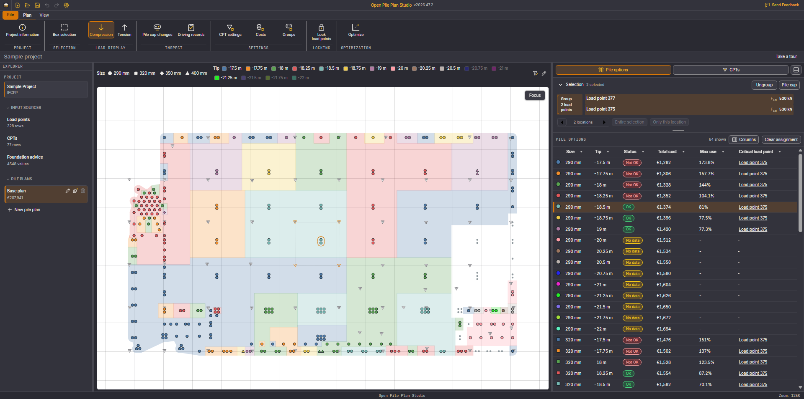

<h1 align="center">Open Pile Plan Studio</h1>

<p align="center">
  <strong>Explore, compare, and assign pile configurations for structural load points.</strong>
</p>

<p align="center">
  <a href="RELEASE_NOTES.md"></a>
  <a href="LICENSE"></a>
</p>

<p align="center">
  <a href="https://pile-plan-studio.open-aec.com/"><strong>Try in your browser</strong></a>
  &nbsp;&middot;&nbsp;
  <a href="https://github.com/OpenAEC-Foundation/pile-plan-studio/releases/latest"><strong>Download for Windows, macOS or Linux</strong></a>
</p>

Open Pile Plan Studio is an open-source engineering application for comparing
pile options and assembling pile plans. It brings structural loads, cone
penetration tests (CPTs), foundation advice, and pile costs together on an
interactive drawing. The browser and desktop editions share the same Rust
calculation core.

<p align="center">
  
</p>

> [!WARNING]
> Engineering results require verification by a qualified professional responsible
> for the foundation design. See [Known limitations](docs/known-limitations.md).

## What you can do

- **Bring in project data.** Import or refresh load points, CPTs, and foundation
  advice from CSV or Excel. Review location matches when sources change.
- **Compare and assign pile options.** Select CPTs automatically or manually,
  check compression and optional tension, and compare resistance, utilization,
  and cost by pile size and tip level.
- **Explore plan variants.** Group load points, lock assignments, and compare
  different pile counts. Use HiGHS to minimize cost, limit configuration variety,
  and optionally reduce differences between neighboring locations within a cost budget.
- **Save and share results.** Keep named plan variants in one `.ifcpp` project.
  Export pile lists and revision tables to Excel or CSV.
- **Review driving records.** Compare site measurements with the selected plan,
  inspect warnings, and review driving status on the drawing.

## Get started

Open the browser app or install the desktop edition. From the start screen,
explore the [bundled sample project](sample_project/README.md), open an existing
`.ifcpp` project, or choose **New project** to import your own data.

| Guide | What it covers |
| --- | --- |
| [Project data and imports](docs/project-data.md) | Supported columns and profiles, RFEM, source refresh, and importing an existing pile plan |
| [Driving records](docs/driving-records.md) | Import, matching, checks, and manual status |
| [Table export](docs/table-export.md) | Excel and CSV output, pile numbering, and change tables |
| [Desktop AI connection (MCP)](docs/mcp.md) | Connect a local AI client to the open project in the Windows desktop app |
| [Release notes](RELEASE_NOTES.md) | Changes by release |

## Development

The Rust engineering core lives in `crates/pile-plan-core`. The browser calls it
through `crates/pile-plan-wasm`. The React and TypeScript interface and the Tauri
desktop shell live in `apps/pile-plan-studio`. See [Architecture](docs/architecture.md)
for the project model and optimizer.

To run the browser app locally, install Node.js, stable Rust, and `wasm-pack`
as described in [Build and deployment](docs/deployment.md#development-prerequisites).
That guide also covers production builds and native prerequisites.

```powershell
cd apps\pile-plan-studio
npm ci
npm run dev
```

Run `cargo test --workspace` from the repository root and `npm test` from
`apps/pile-plan-studio` to check changes. Issues and pull requests are welcome.
Report bugs and ideas through the [GitHub issue tracker](https://github.com/OpenAEC-Foundation/pile-plan-studio/issues).

Development has been assisted by AI coding tools. Design decisions, engineering
requirements, review, and validation remain under human responsibility.

## License

Open Pile Plan Studio is licensed under the
[GNU Lesser General Public License v3.0 or later](LICENSE).
