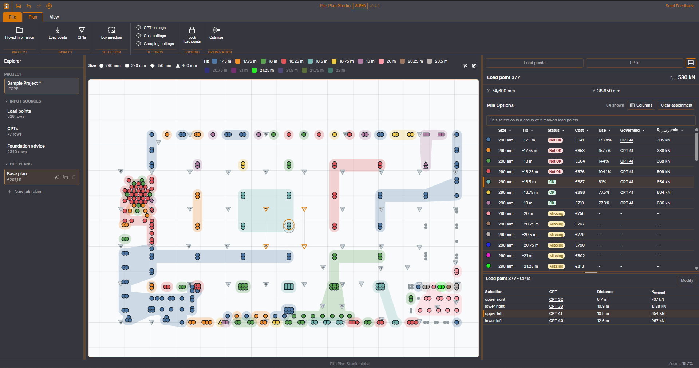
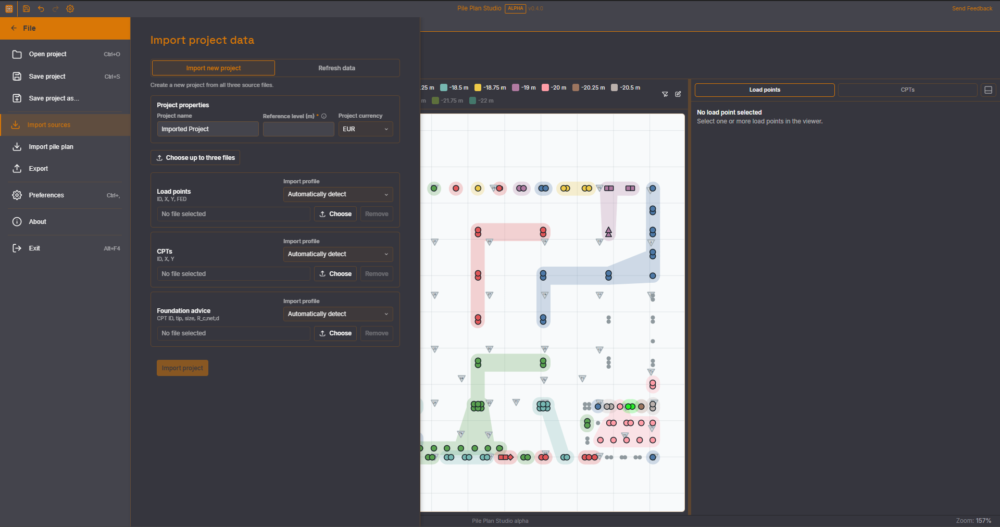
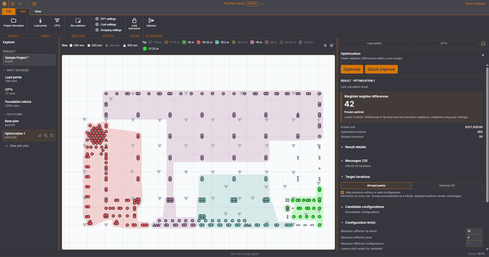

<h1 align="center">Open Pile Plan Studio</h1>

<p align="center">
  <strong>Explore, compare, and assign pile configurations for structural load points.</strong>
</p>

<p align="center">
  <a href="RELEASE_NOTES.md"></a>
  
  <a href="https://github.com/OpenAEC-Foundation/pile-plan-studio/releases"></a>
  <a href="LICENSE"></a>
  <a href="https://pile-plan-studio.open-aec.com/"></a>
  
  
</p>

<p align="center">
  <a href="https://pile-plan-studio.open-aec.com/"><strong>Try Open Pile Plan Studio in your browser</strong></a>
  &nbsp;&middot;&nbsp;
  <a href="https://open-aec.com/open-pile-plan-studio/#download"><strong>Download the Windows installer</strong></a>
</p>

---

Open Pile Plan Studio is an open-source engineering application for reviewing pile
options and assembling a practical pile plan. It brings structural load points,
CPTs, foundation advice, utilization, pile costs, and configuration choices
together in one interactive plan.

The engineering core is written in Rust. The same calculation model runs
natively in the Tauri desktop application and through WebAssembly in the
browser.

<p align="center">
  
</p>

> [!WARNING]
> Open Pile Plan Studio is currently a public alpha. Engineering results must be
> verified by a qualified professional. The application supports engineering
> decisions but does not replace responsibility for the foundation design.

## Highlights

- Check supplied compression and optional tension design loads independently,
  switch their display under **Plan**, and include both in default assignment
  and optimization. Inspect general foundation advice with overrides for
  specific pile counts. The [bundled sample](sample_project/README.md) includes
  explicitly fictional tension resistances for testing.
- Review valid, insufficient, and missing pile options, compare utilization,
  resistance, and cost, and assign configurations to one or many load points.
- Select CPTs automatically using quadrant or maximum-angle rules, override the
  selection manually, and inspect load points and CPTs side by side.
- Import, inspect, and refresh load points, CPTs, and foundation advice while
  retaining matched assignments and CPT selections.
- Organize load points into shared-configuration groups, lock assignments per
  plan, and maintain multiple named pile-plan variants in one project.
- Explore a different pile count using the compact **Pile cap** control beside
  the selection's grouping action, with proposals from 1 to 20 piles. Per-plan
  proposals retain the total FEd,
  show indicative options and costs, and remain available after saving and
  reopening. **Plan > Pile cap changes** opens a compact overview of the active
  plan's original and proposed counts; click a row to select and center its source
  group at the current zoom. The selected group's count, rotation and Reset
  controls are available directly above the list. **Reset all** clears the
  active plan's proposals in one undoable action.
  See [proposal limitations](docs/known-limitations.md#pile-cap-proposals).
- Minimize cost with HiGHS, limit configuration diversity, and optionally
  reduce differences between neighboring load points within a cost budget.
  Existing cap proposals participate at fixed counts; an explicit option allows
  optimizing pile counts in groups and at single-pile locations. Choose individual
  allowed counts and an optimizer maximum (default 6); existing larger counts
  remain available to preserve.
- Customize the plan legend, visible configurations, marker presentation,
  panels, and pile-option columns for compact inspection workflows.
- Save projects as IFCPP with undo, redo, and browser recovery; preview and map
  import columns, review location links, and export assignments, proposed pile
  positions and CPT identifiers to Excel or CSV.
- Keep project costs separate from application preferences while using the same
  Rust calculation core in the browser and Windows desktop application.
- Connect a local AI client to the Windows desktop app through MCP to inspect
  and, when explicitly enabled, edit the open project using the Rust core.

## Screenshots

### Import project data

Import load points, CPT coordinates, and foundation advice from separate CSV or
XLSX sources and assign each file to its project role.

<p align="center">
  
</p>

### Optimize the pile plan

The Optimization panel first finds a constrained cost reference. Optional
coherence optimization reduces weighted tip-level and size differences between
neighbors within a cost budget (5% extra by default). Quick improve provides a
local alternative to the spatial solver. Results distinguish the best solution
found from a proven optimum. See [Architecture](docs/architecture.md#ilp-optimization)
for the model and solver details.

<p align="center">
  
</p>

## Try or Install

The [live browser demo](https://pile-plan-studio.open-aec.com/) opens directly
with the sample project and is the quickest way to explore the application.

The [OpenAEC download page](https://open-aec.com/open-pile-plan-studio/#download)
links directly to the latest published signed Windows x64 installer. Release
history and installer assets remain available on
[GitHub Releases](https://github.com/OpenAEC-Foundation/pile-plan-studio/releases).
After installation, `.ifcpp` project files can be opened directly from Windows
Explorer. If Open Pile Plan Studio is already running, the project opens in the
existing application window.
The browser and desktop editions use the same Rust calculation core.

See the [release notes](RELEASE_NOTES.md) for the changes in each alpha.

## Desktop AI connection (MCP)

The Windows app can expose its currently open project to a local MCP client,
including ChatGPT Desktop or Claude Desktop. Enable the bridge in **Settings →
General → AI connection**, then copy its local address and session token into
the client. Reading is available while connected; project changes require a
second **Allow editing through MCP** switch. The browser demo does not provide
an MCP endpoint.

The client can inspect project data, compare plans, validate and apply bulk
edits, run optimization, import converted CSV sources, and use native file
dialogs for IFCPP save/open and plan export. Project edits pass through the
same Rust engineering checks and project history as the interface. See the
[MCP connection guide](docs/mcp.md) for setup, tool contracts, and examples.

## Supported Project Data

Open Pile Plan Studio imports three source roles:

| Role | Required content | Formats |
| --- | --- | --- |
| Load points | ID, X, Y, F<sub>Ed</sub> | CSV, XLSX |
| CPTs | ID, X, Y | CSV, XLSX |
| Foundation advice | CPT ID, pile tip level, pile size, R<sub>c;net;d</sub> | CSV, XLSX |

In the current version, the standard tabular profile requires these columns to
appear in the order shown in the table. The importer currently reads columns by
position rather than by header name:

- load points: `ID`, `X`, `Y`, F<sub>Ed</sub>;
- CPTs: `ID`, `X`, `Y`;
- foundation advice: `CPT ID`, `pile tip level`, `pile size`,
  R<sub>c;net;d</sub>.

One header row is optional. Additional columns after the required columns
are allowed for CSV and for load-point/CPT imports. For Excel foundation
advice, extra populated columns require recognised standard headings in the
first four positions; empty formatting columns do not count. Every load point
must have an exact unique X/Y position. Source
previews identify all conflicting locations and their shared coordinates; an
import, refresh, or IFCPP project open is rejected until those conflicts are
resolved. Nearby but non-identical positions remain valid. The RFEM load-point
profile is the exception: it detects the
required RFEM columns by their headers. When those headers cannot be detected,
it falls back to the traditional RFEM layout with nodes on the first worksheet
and nodal reactions on the second.

Foundation advice also supports the **Sizes in columns** Excel profile: rows
contain CPT ID and pile tip level, with one resistance column per pile size.
Recognized headings include `Sondering` / `CPT ID`, `PPN` / `Paalpuntniveau`,
and `Prefab 290`, `290 mm`, `#290`, or bare size headings such as `250` and `290`.
Headings stored as numbers or numeric text are equivalent. With generic first
headings such as `Kolom1` and `Kolom2`, explicitly choose **Sizes in columns**:
the first column is CPT ID, the second tip level in metres, and the remaining
columns contain resistances for the sizes in the headings (millimetres).
Generic headings `Column1`/`Column2`, also with spaces, are supported in the
same fixed order. A recognised size matrix can never fall back to the standard
four-column parser, even after an explicit incorrect profile choice or a value
error. The preview explains the required profile or source correction.
Headers must occur within the first 20 rows. A limited two-row header is
supported. A clean matrix may come from a pivot table; free-form report layouts
must be supplied as a supported table. Levels use metres, sizes millimetres,
and resistances kN. Numeric text and surrounding spaces in advice values are
accepted; units in numeric data cells and ambiguous number separators are not
inferred. Empty resistance cells remain missing; zero is a value.
Formulas require a cached numeric result from the spreadsheet application.

Each advice file has its own import card. Add further files below it; choose
which worksheets to combine when a workbook has multiple sheets. Combine only
advice with compatible assumptions. Identical values for the same CPT, size,
and millimetre tip level are deduplicated. Different values block import, even
for CPTs without known coordinates. Conflict details show all values and source
cells. No intermediate tip levels are inferred.

When refreshing, **Replace** affects the selected existing advice only;
**Add foundation advice** retains the existing advice and adds the selected
sources. The complete refresh is validated and applied as one undoable change.
Older projects without source ownership show one combined existing advice;
replacing that card replaces the combined advice.

Pile tip levels are expressed in metres and may resolve to whole millimetres
(up to three decimal places). Finer values are rejected with their source
locations instead of being rounded. The interface omits unnecessary trailing
decimals while retaining enough digits to distinguish every valid level.

The source files may be selected together and assigned to their roles before
import. The general source picker retains every recognized foundation-advice
file as a separate source, including mixed selections with load points and CPTs.
Filename recognition includes advice/resistance names and pile-specific
compression/tension names such as the VEGA `prefab ... trek diep/ondiep`
workbooks. Explicit load names such as `Trekbelastingen`, `Trekkrachten` and
RFEM remain load-point sources. Each advice still has its own worksheet
selection and import settings; filenames do not determine cap-count validity.
Unrecognized filenames can be selected through the corresponding source card.
Load points can use either the standard tabular profile or the
automatically detected RFEM Excel export profile. The RFEM profile joins node
coordinates and reactions by node number and currently interprets the design
load as the absolute value of the minimum PZ envelope (`Min PZ'`, `Min PZ`, or
`Min`). It also recognises the RFEM 6 component-envelope reaction layout, with
or without column headers: each node has two `Pz` rows, whose smaller signed
PZ value governs. Per-node `Extremes` rows and the Dutch/English overall
max/min summary are ignored, including the unlabelled twelve-row summary after
the final node's extremes. An incomplete or repeated PZ pair is rejected.
Both the coordinates and reactions must be in the same XLSX workbook. In the
RFEM 6 Cartesian coordinate layout, the importer uses the global X/Y columns
(I/J), rather than the input-coordinate columns (F/G), and accepts headerless
data starting on the first row. The legacy coordinate layouts remain supported.
An additional nodal-support table is optional and is ignored, regardless of
how many support types it contains. Imported load points are the node numbers
present in both the coordinate and reaction tables; a support table cannot
recover reactions omitted by the selected result export or its filters.

When refreshing load points, **Check location links before refreshing** opens an integrated
matching workspace with a large pan/zoom plan and an editor on the right. Pick
a new location, then its old partner on the plan. Layers and link lines can be
toggled independently; lines initially show all pairs. The old-location
inspection tool also handles coincident points and unpaired removals. The
sidebar opens on unresolved locations, ready to pick the first old partner. Each
link, addition or removal advances to the next unresolved location. Question
badges and clickable progress counters show what remains. Old selection/hover
uses a navy dashed ring; new selection/hover uses a solid orange ring. Escape
or an empty canvas click clears selection; dragging still pans. The coordinate
grid starts enabled and follows the shared viewer pan/zoom. All connection lines
are shown initially as thin straight center-to-center lines above the symbols;
coincident locations show no line. Selected-only and hidden modes remain available. Nearest/separate
bulk actions are always visible above the drawing. Taking an occupied partner
releases the previous edges and returns the displaced locations to review.
All links can still be edited using the viewer or one explicit sidebar editor. Node
numbers are not treated as stable identities. Automatic matching uses a separate
1 mm tolerance by default and only accepts reciprocal unique matches. Every
link can be changed; remaining locations can be paired by nearest distance or
explicitly treated as added/removed. Confirm the review before applying the
refresh. Linked choices, locks and CPT settings follow the new node numbers in
all plans; added points remain unassigned. Old optimization results are cleared. A load-only refresh preserves the existing
foundation-advice rows; it does not re-import unchanged legacy advice. New or
replaced advice and CPT changes retain the ordinary validation rules.
Pile-cap proposal members are remapped; proposals containing removed members
are discarded with a warning. Changed group membership remains subject to the
usual core validation and conflict display. The complete refresh is one undo
step.

Imported data, source profiles, project settings, selected piles, and manual
CPT choices are stored in an `.ifcpp` project file.

When creating a project from source files, the building reference level is
required. Open Pile Plan Studio uses this reference as the pile cut-off level when
calculating pile lengths and costs.
The project currency defaults to the user's application preference. Changing a
currency code relabels costs; Open Pile Plan Studio does not perform currency
conversion.

The built-in pile-cost defaults and their assumptions are documented in
[`docs/pile-cost-defaults.md`](docs/pile-cost-defaults.md).

### Import an existing pile plan

Use **File > Import pile plan** to add an Excel or CSV table as a new pile plan
inside the active project. The imported plan is named after the source file and
opened immediately; existing plans remain unchanged. The Standard table
profile supports both pile assignments and CPT selections. The Legacy profile
supports existing `Vergrendeld.xlsx` files and imports pile assignments only;
rows that describe more than one pile are skipped with a warning.

Load points are first matched by ID when the imported coordinates agree. If
that check fails, Open Pile Plan Studio falls back to one unique coordinate match.
The coordinate tolerance is configurable for this workflow and defaults to
1 mm. Ambiguous, unmatched, or conflicting rows are skipped and reported in
the import preview before the project is changed.

## Selection and Inspection

- Click a load point to select it, or its entire effective group when grouped.
- Use **Shift+click** to add or remove a complete group from the selection.
- Use **Shift+drag** on empty viewer space to select load points with a lasso;
  touching one group member includes its entire group.
- Hover over a marker to inspect its compact information.
- When markers overlap, press **Space** to cycle through the candidates beneath
  the pointer before clicking.
- Use **Shift+click** on a pile size or tip level in the legend to select load
  points that currently use it.
- Press **Escape** or click empty viewer space to clear the selection.

The selection header lists members of a selected group. Choose a member there
to inspect just that load point without changing its group. Its orange selection
ring then appears alongside a gray group contour (red if the group conflicts),
even if **Show groups** is off. A pile assignment still applies to the whole
group. Group and ungroup actions are available beside the selection header and
in the grouping settings.
Manual groups must be connected in the project's Gabriel graph. Ungrouping an
automatic group stores an explicit separation; ungrouping a manual group removes
that manual override. The grouping settings show both override counts and can
reset them in one undoable action. **View > Show groups** draws gray contours for
unselected groups of two or more load points. A group with conflicting
assignments has a warning and a red contour, which becomes orange when the
whole group is selected.

In the pile-options table, click a row to assign its configuration. With
multiple load points selected, the table shows their common options and applies
the chosen configuration to all of them. Column headers support sorting and
filtering.

Use **Columns** to show or hide columns and drag them into order. Single-point
and multiple-point layouts are remembered separately as application preferences.
Filters and sorting on hidden columns are inactive until those columns return.
The third button beside **Load points** and **CPTs** opens the combined view;
drag its divider to adjust the space for each section. Close an input-source
table with its top-right close button to return to the pile plan.

## Alpha Scope

The CPT-selection rules are configurable approximations rather than an
objective engineering truth. Optimization proves optimality only when reported
by the solver for the configured model. Quick improve and interrupted runs can
return feasible plans without proving that no better plan exists.

See [Known Alpha Limitations](docs/known-limitations.md) for the complete scope.

## Architecture

| Layer | Technology | Responsibility |
| --- | --- | --- |
| Engineering core | Rust | Project model, import, CPT selection, pile options, costing, optimization |
| Browser core | WebAssembly | Thin interface to the same Rust engineering core |
| Interface | React + TypeScript | Application state, interaction, rendering, and presentation |
| Desktop | Tauri 2 | Native window, file access, and Windows packaging |

Repository layout:

- `crates/pile-plan-core`: engineering domain and calculations;
- `crates/pile-plan-wasm`: WebAssembly interface;
- `apps/pile-plan-studio`: React application and Tauri desktop shell;
- `sample_project`: example IFCPP project and source files;
- `docs`: architecture, deployment, screenshots, and limitations.

See [Architecture](docs/architecture.md) for more detail.

## Build from Source

Requirements:

- a current Node.js 22 or 24 release (CI uses 22);
- current stable Rust;
- `wasm-pack`;
- the [Tauri prerequisites](https://v2.tauri.app/start/prerequisites/) for
  desktop builds.

Native Rust tests and desktop builds also need the C++ toolchain, CMake, and
libclang used by HiGHS. See [Build and deployment](docs/deployment.md) for setup
and the separate Tauri test command.

Run the browser development server:

```powershell
cd apps\pile-plan-studio
npm install
npm run dev
```

Run the automated tests:

```powershell
cargo test --workspace
cd apps\pile-plan-studio
npm test
```

Create the browser and Windows desktop builds:

```powershell
cd apps\pile-plan-studio
npm run build
npm run tauri build
```

See [Deployment](docs/deployment.md) for browser hosting and signed release
details.

## Contributing

Issues and pull requests are welcome. Keep engineering logic in the Rust core,
add focused tests for behavioral changes, and keep browser and desktop behavior
on the same project model.

Report bugs and ideas through the
[GitHub issue tracker](https://github.com/OpenAEC-Foundation/pile-plan-studio/issues).

### AI-assisted Development

Development of Open Pile Plan Studio has been assisted by AI coding tools. Design
decisions, engineering requirements, review, and validation remain under human
responsibility.

## License

Open Pile Plan Studio is licensed under the
[GNU Lesser General Public License v3.0 or later](LICENSE).

### Export columns, numbering and change tables

Under **File > Export**, choose the pile plan to export (initially the currently
viewed plan). This choice is shared with change tables and does not switch the
viewer or edit the project. **Column settings** and **Table preview** are separate
collapsible sections, initially closed in both export modes. Collapsing them
preserves the settings and preview. Add or remove columns and drag their grips to
change the order. Select a column to edit its caption and content. Added columns
use their plain default caption when it is available, such as `Mark`. Only
when that caption already exists is a free numeric suffix added (`Mark 1`,
`Mark 2`, …), to avoid duplicate headers. The editor reserves its space while the preview updates to preserve
scroll position. Default
captions follow the interface language; custom captions and imported source
captions are preserved. Focus a
grip and use the arrow keys, Home or End to reorder with the keyboard. Column
settings include size notation (numeric, dimensions or a custom template),
coordinate/level units, fixed text, Mark numbering and tip-level codes. The
preview shows the first 12 rows; exported files contain all rows. Column choices
and numbering rules are application preferences. The default remains the
original seven columns; Marks and tip codes are optional.

Marks can run by rows or columns with independent X/Y directions, a starting
number and a row/column tolerance (default 1 mm). A group spans at most that
tolerance; nearby rows do not join through a chain of intermediate points.
Tip codes can use `A, B, C, …` (including `AA` after `Z`) or `1, 2, 3, …`, ordered
from high to low or low to high. Size templates support `{size}`, `{width}`,
`{height}` and `{diameter}`. Dimensions render square piles as `290x290` and round
piles as `Ø290`.

Choose **Create change table** to compare a previous XLSX/CSV pile-plan table
from Pile Plan Studio, Revit or another program with the active fully assigned
plan or a new pile-plan file. Check the detected worksheet, header row and source
columns; map custom captions manually. The previous table requires X/Y only.
Missing optional size/shape and level information is indicated and is not
invented for comparisons. Numeric old sizes can be given a square/round shape
hint. Source units and custom size templates can be set explicitly. A new file
requires unique location IDs, coordinates, size/shape and tip level. Numeric
new sizes can use the current project's known shapes.

Automatic matching uses a 99 mm tolerance by default. Review and confirm links
in the visual matching workspace used for source refresh. In the default numbering mode linked Marks stay
unchanged and active rows receive the new location IDs. New Marks start above
the highest old Mark, including removed piles. Missing old Marks are generated
using the selected rule when an output Mark column is requested. The proposed
numbering rule is detected from existing Marks and can be adjusted; equally
fitting rules are indicated. Alternatively choose **Renumber the entire new pile
plan** to number all active new locations from the chosen start using the rule.
Removed rows keep their old Mark in both modes; those old numbers may also occur
in the newly numbered plan. Renumbering alone does not add a change code. The
tolerance is chosen, not inferred uniquely.

By default the output retains previous columns/order and additional cell values
and includes `Wijzigingscode`: `M` for XY movement strictly greater than 99 mm,
`S` for size/known shape change, `L` for numeric tip-level change, `A` for
additions and `R` for removals. Configure each code, its inclusion, the separator
and movement threshold in the change-code column settings. This column can be
renamed, moved or excluded like any other output column. Removed rows remain
present even if the code column is excluded. They retain their old ID, Mark and
other values; an old ID may also occur as a new active node ID. Active tip codes
are regenerated; a changed code alone does not produce `L`. Added rows leave
unavailable previous metadata blank. Only cell values carry over, not workbook
formulas, styling or other sheets. Source mappings, output changes and links
for the comparison are transient. The tool exports a table; it does not update
another program or keep a revision database.
