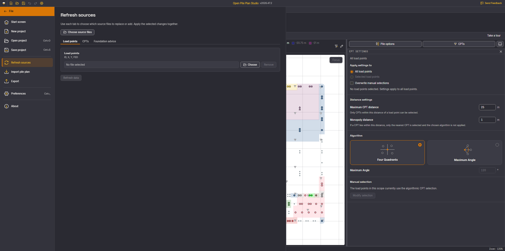

# Project data and imports

Use **File > New project** to start the guided import. Enter the project details,
then select the load-point, CPT, and foundation-advice sources. You can select
files together and review their suggested roles, or add them from the individual
source cards. In the preview, check the worksheet, header or data row, column
mapping, and units before importing.

## Supported source tables

| Source | Standard columns in default order | Formats |
| --- | --- | --- |
| Load points | ID, X, Y, compression FEd | CSV, XLSX |
| CPTs | ID, X, Y | CSV, XLSX |
| Foundation advice | CPT ID, pile tip level, pile size, design resistance Rc;net;d | CSV, XLSX |

Standard tables can have one header row or start directly with data. The default
column mapping uses the positions shown above. CSV and load-point/CPT tables can
have additional columns. For standard Excel advice with extra populated columns,
use recognized standard headings in the first four positions. Empty formatting
columns are ignored.

Load points must have unique X/Y coordinates. The preview lists conflicting
locations and their shared coordinates. Resolve exact duplicates before import,
source refresh, or IFCPP open. Nearby distinct coordinates are valid.
For optional tension loads, map a separate column in kN. An empty cell means
missing input. Enter `0` for a known zero tension load.

The building reference level is required. It serves as the pile cut-off level
for length and cost calculations. The project's currency starts from the
application preference. Changing the currency code relabels the amounts without
converting them. See [Pile cost defaults](pile-cost-defaults.md) for the cost
assumptions. An `.ifcpp` file stores the data, source profiles, settings, pile
plans, and manual CPT choices.

### CPT coordinate systems

When the CPTs and load points share the same system, select **Drawing
coordinates**. For a different planar coordinate system (such as RD), select
**Transform source coordinates**. First check the X/Y source column units, then
enter the source position of drawing (0, 0) in those same units. Optionally
enter the counterclockwise angle from the source X-axis to the drawing X-axis
in degrees (zero for parallel axes).

The import preview displays the original coordinates and transformed drawing
coordinates in millimetres. The project remembers the transformation for CPT
refreshes.

### RFEM load points

Use the **RFEM** Excel profile when node coordinates and reactions are in the same
`.xlsx` workbook. The importer detects supported headers and falls back to nodes
in the first sheet and reactions in the second for traditional exports. It joins
the tables by node number and only imports nodes present in both. An optional
support table is ignored. The RFEM 6 Cartesian layout uses global X/Y in columns
I and J and supports data without headers.

Compression uses `max(0, -Min PZ)` and optional tension uses `max(0, Max PZ)`.
Supported minimum headings include `Min PZ'`, `Min PZ`, and `Min`. The RFEM 6
component-envelope layout uses two `Pz` rows per node. The importer requires a
complete pair and skips the per-node extremes and overall summary rows.

### Foundation advice

Use the standard table above or the **Sizes in columns** Excel profile. In the
matrix, each row starts with CPT ID and pile tip level, followed by one resistance
column per pile size. Recognized headings include `Sondering` or `CPT ID`, `PPN`
or `Paalpuntniveau`, and sizes such as `Prefab 290`, `290 mm`, `#290`, or `290`.
Numeric size headings and their text equivalents are accepted. With generic
headings such as `Kolom1` and `Kolom2` or `Column 1` and `Column 2`, choose
**Sizes in columns** explicitly and keep CPT ID and tip level in the first two
columns. Headers must be in the first 20 rows, and some two-row headers are
supported. A detected matrix must use the matrix profile.

Levels use metres, sizes use millimetres, and design resistances use kN. Tip
levels must resolve to whole millimetres. The importer reports finer values with
their source locations. It accepts numeric text and surrounding whitespace.
Use plain numbers without unit suffixes or ambiguous separators. Empty
resistance cells remain missing, zero is a value, and formulas need cached
numeric results. Resistance is available at the supplied tip levels.

Standard advice can map compression and tension to separate columns in the same
table. For matrix advice, supply separate worksheets for the two directions.
Advice can also carry overrides for specific pile counts. Check each source's
settings and combine only advice with compatible assumptions.

Each advice file has a separate card. For a workbook, choose the worksheets to
combine. Identical entries for the same CPT, size, tip level, load direction,
and pile-count scope are deduplicated. Conflicting values block import and the
preview lists their source cells, including conflicts for CPTs without known
coordinates.

## Refresh project sources

Use **File > Refresh sources** to replace or add load points, CPTs, or advice.
In the advice tab, **Replace** affects the selected existing source and **Add
foundation advice** keeps existing sources. Older projects without source
ownership show one combined advice card. Replacing that card replaces the
combined advice.

For changed load points, open **Check location links before refreshing**. Automatic
matching suggests reciprocal, unique coordinate matches within a default 1 mm
tolerance. In the matching workspace, confirm or change links, or mark locations
as added or removed. Use the bulk actions to link remaining nearest locations or
mark them as added or removed. Confirm the review to apply the refresh.

Linked locations retain assignments and locks in each plan, along with their
project-wide manual CPT choices. Added locations start unassigned and previous
optimization results are cleared.
A load-only refresh keeps the existing advice rows. Pile-cap proposals follow
their linked members and proposals with removed members are discarded with a
warning. The complete refresh is one undo step.

## Import an existing pile plan

Use **File > Import pile plan** to add a CSV or Excel pile-plan table to the open
project. The imported plan takes its name from the file. The **Standard** profile
supports pile assignments and manual CPT selections, which are shared across
plans. The **Legacy** profile imports assignments from `Vergrendeld.xlsx` and
skips rows describing more than one pile with a warning.

Map the location ID, X/Y coordinates, or both. When both are available, the
importer first checks that the ID and coordinates agree, then falls back to a
unique coordinate match. The default coordinate tolerance is 1 mm. Review
ambiguous, unmatched, or conflicting rows in the preview. You can reassign or skip
rows before importing. An optional `Mark` or `Revit Mark` column is stored on
the linked locations in the imported plan and can be used for [driving record
matching](driving-records.md#import-and-match-files).
